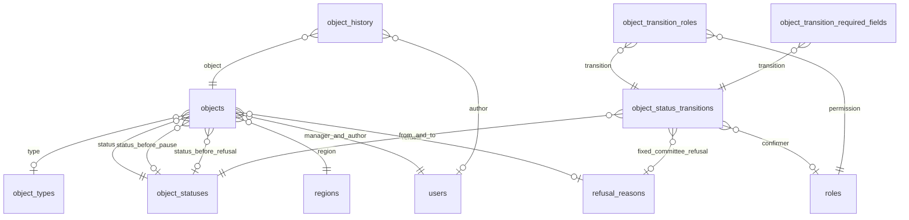

# Модель даних об'єкта

T5770. Джерела: критерії задачі, відповіді клієнта та [Wiki проєкту](https://keyspace.workflowcrm.com.ua/it-space/projects/cmroz0rd20069pe3ilypzx6s4?projectTab=wiki): Overview, Product Requirements Documents, Application Structure. Актуальні поля та правила тригерів від 05.10.2026 описані в [object-fields.md](object-fields.md). Доопрацювання 02.10.2026 за таблицею T6712 описане в [object-transition-policy.md](object-transition-policy.md); воно замінює початкові правила переходів нижче.

## Межі задачі

Модуль `objects` отримує модель зберігання, довідники, правила переходів і журнал змін. Категорії файлів належать модулю `files`. Між модулями зберігаються UUID, без імпорту внутрішніх JPA-сутностей `users`.

HTTP CRUD, виконання переходів, погодження запитів, перенесення точки входу, створення задач, сповіщення та перевірка доступу до файлів реалізуються окремими сценаріями. Наявність рядка переходу сама по собі не дозволяє користувачу виконати його: майбутній сервіс перевіряє активність правила, роль, відповідального менеджера, регіон, підтвердження та обов'язкові поля в одній транзакції.

## Об'єкт

`objects` — кандидат на відкриття магазину. UUID — первинний ключ. Довідники мають стабільний унікальний код; їх UUID генеруються базою, а зовнішні ключі визначаються за кодами під час сіду.

| Поле | Тип | Правило |
|---|---|---|
| `name` | varchar(500) | У новому POST /api/objects заповнюється з назви або адреси; історичні null у БД збережені |
| `object_type_id` | UUID → object_types | Необов'язковий |
| `address` | varchar(500) | Необов'язкова; задане значення непорожнє |
| `region_id` | UUID → regions | Обов'язковий |
| `manager_id` | UUID → users | Відповідальний менеджер, обов'язковий |
| `status_id` | UUID → object_statuses | Обов'язковий; нова сутність має `FOUND` |
| `status_before_pause_id` | UUID → object_statuses | Попередній статус: сценарій паузи зберігає його, відновлення повертає саме в нього |
| `status_before_refusal_id` | UUID → object_statuses | Етап до відмови; при відмові з паузи зберігається етап до паузи |
| `entrance_longitude` | numeric(10,7) | Обов'язкова довгота WGS84, від -180 до 180 |
| `entrance_latitude` | numeric(9,7) | Обов'язкова широта WGS84, від -90 до 90 |
| `object_area`, `land_area` | numeric(14,2) | Хоча б одна; кожна задана площа додатна, у м² |
| `contact_name`, `contact_role` | varchar(200), varchar(100) | Знімок первинного контакту для сумісності; необов'язковий до Epic Contacts; заданий контакт має ім'я та роль |
| `contact_phone`, `contact_email` | varchar(64), varchar(320) | Якщо контакт заданий, хоча б один непорожній канал зв'язку |
| `commercial_terms` | text | Історичний текст; актуальний блок — `CommercialTerms` |
| `technical_specifications` | text | Історичний текст; актуальний блок — `TechnicalSpecifications` |
| `contract_type_id` | UUID → contract_types | Основний / Попередній; старий `contract_type` збережений для сумісності |
| `investment_committee_decision` | varchar(32) | `APPROVED`, `APPROVED_WITH_CONDITIONS`, `REFUSED` або null |
| `investment_committee_date` | date | Задається разом із рішенням ІК |
| `investment_committee_conditions` | varchar(50) | Обов'язкові при новому `APPROVED_WITH_CONDITIONS`; довгі історичні значення збережено окремо |
| `investment_committee_refusal_comment` | varchar(50) | Коментар відмови ІК |
| `refusal_reason_id` | UUID → refusal_reasons | Обов'язковий при відмові ІК; для ручної відмови — обов'язкове поле правила переходу |
| `contract_signed_date` | date | Обов'язкове поле переходу до підписаного договору |
| `opening_date` | date | Обов'язкове поле переходу до відкриття; не раніше підписання |
| `author_id` | UUID → users | Обов'язковий, автор створення |
| `created_at`, `updated_at` | timestamptz | UTC; початкове значення CURRENT_TIMESTAMP |
| `version` | bigint | Початкове 0; JPA `@Version` збільшує при оновленні |

Координати не використовують PostGIS. Значення більш ніж із сімома знаками після коми відхиляються доменною моделлю, щоб уникнути непомітного округлення. Площі мають не більше двох знаків.

Для комерційних і технічних параметрів поки не погоджено набір окремих полів. Два текстові розділи дозволяють зберігати опис без вигаданих структурованих показників. Коли клієнт затвердить склад параметрів, типізовані колонки додаються новою міграцією. Дані Geo-M поки не входять до моделі: показники та шари ще не обрані.

Доопрацювання T5771 додає `contacts` і `object_contacts`: один контакт може бути пов'язаний з кількома об'єктами, один об'єкт — з кількома контактами. При створенні передається `contactId` доступного контакту або дані нового `contact`; об'єкт, контакт, зв'язок, ключ повторного запиту та журнал зберігаються в одній транзакції. Обов'язковість контакту вмикається після Epic Contacts. Старі поля контакту зберігаються як знімок для сумісності; довідник, пошук, редагування та розкриття телефону належать окремим сценаріям Epic Contacts. Деталі — у [контракті створення](object-creation.md).

`BaseEntity` підтримує час створення, час зміни та optimistic locking. Оновлення об'єкта має проходити через JPA; зовнішній SQL без перевірки й збільшення `version` обходить optimistic locking і не є підтримуваним способом редагування. При конкурентному збереженні застаріла версія відхиляється, перша зміна зберігається.

## Довідники

У `object_statuses`: унікальні `code` і `sort_order`, назва, `is_final`, `is_active`, час і версія. Ознака тригера обчислюється за наявністю активного шаблону Tasks; колонки `is_task_generation_trigger` більше немає. Порядок основного шляху має проміжки для майбутніх етапів. Пауза й відмова — відгалуження, їх позиція в довіднику не визначає порядок переходів.

| Код | Назва | Порядок | Фінальний |
|---|---|---:|---|
| FOUND | Знайдено | 10 | Ні |
| IN_PROGRESS | У роботі | 20 | Ні |
| IC_PREPARATION | Підготовка на ІК | 30 | Ні |
| COMMERCIAL_TERMS_APPROVAL | Погодження ком. умов | 40 | Ні |
| CONTRACT_APPROVAL | Погодження договору | 50 | Ні |
| CONTRACT_SIGNED | Договір підписано | 60 | Ні |
| OPENED | Відкрито | 70 | Так |
| PAUSED | На паузі | 80 | Ні |
| REFUSED | Відмова | 90 | Ні, боковий статус із можливістю повернення |

Всі статуси активні. Ознака тригера залежить від активного шаблону Tasks; фіксованих прапорців у сіді немає. Склад шаблонів задач погоджується з клієнтом.

Активні типи об'єкта: Земельна ділянка, Вбудоване приміщення, ТЦ, Ангар. Перший поверх житлового збережений як неактивний історичний тип.

Причини відмови: Комерційні умови, Умови договору, Тех. параметри, Малий потенціал, Програли конкурентам, Не погоджено на ІК. Ознака is_system_only увімкнена тільки для IC_NOT_APPROVED.

Категорії файлів: Медіа, Технічна документація, Правовстановлюючі, Договори, Інше. Тільки `CONTRACTS` має `is_restricted=true`. Обмеження категорії є метаданими, а не реалізацією авторизації. Доступ до договорів має включати відповідального менеджера, роль погодження договорів і керівництво згідно з відповіддю клієнта.

## Початкова конфігурація переходів 01.10

Актуальні 17 правил T6712, дії з задачами та обмеження повернення з відмови — в [object-transition-policy.md](object-transition-policy.md). Початкова конфігурація нижче зберігається як опис стану для rollback.

`object_status_transitions` містить унікальний код правила, початковий і кінцевий статуси, ознаку підтвердження, UUID ролі підтвердження, ознаки системного переходу, повернення й активності, значення рішення ІК для автоматичного переходу, умову переходу та фіксовану причину відмови ІК.

`object_transition_roles` пов'язує правило з дозволеними ролями через зовнішні ключі до `roles`. `object_transition_required_fields` містить перелік обов'язкових полів. Складені первинні ключі виключають дублікати ролей і полів у правилі. Окремі правила для одного напрямку дозволяють розрізняти прямий перехід і запит на погодження.

| Напрямок | Ініціатор | Підтвердження | Обов'язкові дані |
|---|---|---|---|
| Між FOUND та IN_PROGRESS; рання пауза й відмова; повернення з REFUSED у FOUND / IN_PROGRESS / PAUSED | MANAGER, REGIONAL_MANAGER, DEVELOPMENT_DIRECTOR | Немає | Причина ручної відмови |
| FOUND / IN_PROGRESS → IC_PREPARATION | REGIONAL_MANAGER, DEVELOPMENT_DIRECTOR | Немає | — |
| Ті самі → IC_PREPARATION, запит менеджера | MANAGER | REGIONAL_MANAGER | — |
| IC_PREPARATION → COMMERCIAL_TERMS_APPROVAL | Система, APPROVED | Немає | Дата ІК |
| IC_PREPARATION → COMMERCIAL_TERMS_APPROVAL | Система, APPROVED_WITH_CONDITIONS | Немає | Дата та умови ІК |
| IC_PREPARATION → REFUSED | Система, REFUSED | Немає | Дата ІК; фіксована причина IC_NOT_APPROVED |
| COMMERCIAL_TERMS_APPROVAL → CONTRACT_APPROVAL | REGIONAL_MANAGER, DEVELOPMENT_DIRECTOR | CONTRACT_MANAGER | — |
| CONTRACT_APPROVAL → CONTRACT_SIGNED | REGIONAL_MANAGER, DEVELOPMENT_DIRECTOR, CONTRACT_MANAGER | Немає | Дата підписання |
| CONTRACT_SIGNED → OPENED | REGIONAL_MANAGER, DEVELOPMENT_DIRECTOR | Немає | Дата відкриття; дефолт FR-96 до рішення клієнта |
| Повернення на попередній основний етап | REGIONAL_MANAGER або DEVELOPMENT_DIRECTOR | Немає | — |
| IC_PREPARATION / COMMERCIAL_TERMS_APPROVAL / CONTRACT_APPROVAL / CONTRACT_SIGNED → REFUSED | REGIONAL_MANAGER, DEVELOPMENT_DIRECTOR | Немає | Причина ручної відмови |
| REFUSED → будь-який основний статус | REGIONAL_MANAGER, DEVELOPMENT_DIRECTOR | Немає | Дата підписання для CONTRACT_SIGNED; обидві дати для OPENED |
| Будь-який нефінальний статус → PAUSED | Ранні етапи: менеджер або керівництво; з ІК: тільки керівництво | Немає | Збереження статусу до паузи |
| PAUSED → попередній статус | Ранні етапи: менеджер або керівництво; з ІК: тільки керівництво | Немає | RESUME_PREVIOUS_STATUS |

Повернення основним шляхом: IC_PREPARATION → IN_PROGRESS; COMMERCIAL_TERMS_APPROVAL → IC_PREPARATION; CONTRACT_APPROVAL → COMMERCIAL_TERMS_APPROVAL; CONTRACT_SIGNED → CONTRACT_APPROVAL; OPENED → CONTRACT_SIGNED. Всього 47 правил, 46 активні. Старий `REQUEST_PAUSED_TO_IC` вимкнений: спочатку відновлюється попередній статус, потім запитується новий перехід. `LEAD_PAUSED_TO_IC` тепер є відновленням тільки тоді, коли статус до паузи — IC_PREPARATION.

`condition_code=RESUME_PREVIOUS_STATUS` вимагає рівності цільового статусу й `status_before_pause_id`. Такий перехід відновлює задачі, не створює новий набір і не змінює їх строки автоматично. `EARLY_STATUS_BEFORE_PAUSE` дозволяє менеджеру ручну відмову з паузи лише тоді, коли збережений статус — FOUND або IN_PROGRESS. Для керівництва ручна відмова з паузи має окреме правило без цього обмеження. При переході REFUSED → PAUSED попереднім статусом є REFUSED; є окреме правило його відновлення.

Ці умови — метадані для майбутнього сервісу переходів. Вони не виконуються автоматично на рівні БД. Сервіс має перевірити їх разом із роллю та видимістю об'єкта, записати або очистити статус до паузи і застосувати `fixed_refusal_reason_id` для IC_REFUSED. Стан ІК, дати та історія також перевіряються сценарієм повернення з відмови.

Менеджеру не додано правил ручної відмови або інших змін зі стадії IC_PREPARATION і далі. Автоматичні переходи ІК не мають ролей користувачів. Системне правило не може одночасно вимагати підтвердження. Підтверджувач обов'язковий саме для правил із `is_confirmation_required=true`.

При виконанні повернення майбутній сценарій скасовує незавершені задачі, сповіщає виконавців і залишає виконані задачі в історії. Повторний вхід у статус створює задачі заново. Ця міграція не створює шаблони задач.

«Провідний» відповідає існуючій ролі `REGIONAL_MANAGER`: Владислав підтвердив зіставлення 01.10.2026 о 18:57. Директор має той самий набір активних правил за межами регіональних обмежень. CEO не має дозволів на зміну статусу. Вибір директора як резервного погоджувача за відсутності провідного виконується майбутнім сервісом погоджень, відповідно до Application Structure.

## Журнал і зв'язки

`object_history` зберігає UUID об'єкта, автора для дій користувача, тип автора `USER` / `SYSTEM`, назву зміненого поля, попереднє й нове значення, версію об'єкта, час запису та технічну версію. Для системного запису `author_id` відсутній. JPA-модель незмінна, репозиторій надає додавання та читання історії. Запис об'єкта й історії має виконуватися в одній транзакції майбутнього сценарію редагування.



Зовнішні ключі та поля фільтрації мають індекси. Видалення користувачів, регіонів, довідників або об'єктів із залежною історією обмежено `RESTRICT`. Видалення правила прибирає лише його дочірні ролі й обов'язкові поля через `CASCADE`. Інші модулі не змінюються.

## Міграції й перевірка

Нові changeset: `20261001_objects_model`, `20261001_objects_reference_data`, `20261001_objects_workflow_revision`, `20261001_file_categories`. Раніше опубліковані changeset не редагуються. Оновлення правил 01.10 додане окремим changeset, який працює й поверх первинного сіду. Міграції виконуються стандартним Liquibase при старті застосунку. Сіди не створюють користувачів, регіонів або тестових об'єктів.

Rollback нових чотирьох changeset повертає структуру до попереднього стану. Він видаляє нові таблиці разом із даними об'єктів; запускати на робочій базі можна лише після резервування даних і погодження. Окремий rollback ревізії повертає первинні дозволи, прапорці та схему переходів, зберігаючи UUID довідників і дані об'єктів. Окремий rollback сіду відхиляється за наявності залежних об'єктів завдяки зовнішнім ключам. Повторний `update` не змінює кількість рядків або UUID довідників.

```bash
cd backend
./mvnw clean verify -Pintegration
```

| Критерії | Перевірка |
|---|---|
| 1: таблиці | ObjectSchemaMigrationIT.createsAllObjectTablesAndUsesNumericCoordinatesWithoutPostgis |
| 2: поля об'єкта | persistsObjectWithAllRequiredFieldsAndIncrementsVersionOnUpdate, обмеження площі, контакту та FK |
| 3: блок ІК | requiresConditionsForConditionalCommitteeApproval, persistsCommitteeRefusalAndSigningAndOpeningDates |
| 4: дати | persistsCommitteeRefusalAndSigningAndOpeningDates |
| 5: статуси та прапорці | seedsNineStatusesAndFinalOpenedStatus |
| 6: модель переходів | modelsLeadAndContractConfirmationAndSystemOnlyCommitteeTransitions |
| 7: дев'ять статусів | seedsNineStatusesAndFinalOpenedStatus |
| 8: правила переходів | allowsManagerOnlyEarlyTransitionsAndRequiresRefusalReason, limitsSigningAndReturningAndUsesDocumentedOpeningDefaults, givesDirectorTheSameActiveWorkflowRulesAsLeadAndKeepsCeoReadOnly, modelsPauseRestorationWithoutLettingManagerBypassAdvancedStatusPermissions, allowsLateRefusalAndRestorationOnlyToLeadershipWithRequiredDates |
| 9–11: довідники | seedsExactRefusalReasonsObjectTypesAndFileCategories |
| 12: координати | createsAllObjectTablesAndUsesNumericCoordinatesWithoutPostgis, rejectsCoordinatesOutsideWgs84AtDatabaseLevel, ObjectValuesTest |
| 13: версія | persistsObjectWithAllRequiredFieldsAndIncrementsVersionOnUpdate, rejectsConcurrentUpdateWithStaleVersion |
| 14: rollback | ObjectLiquibaseRollbackIT.rollbackRestoresPreviousSchemaAndPreservesExistingUserData, upgradesPublishedObjectSeedAndRollsBackOnlyWorkflowRevision |
| 15: повторне застосування | secondRunPreservesSeedIdsCountsAndChangelogAndDoesNotDuplicateData |

## Готовність до приймання та подальша конфігурація

Модель, довідники та міграції T5770 готові до приймання. Зіставлення ролі «Провідний» підтверджене Владиславом 01.10.2026 о 18:57; зміна коду або сідів ролей не потрібна.

Питання про статус до паузи закрите FR-12. Таблиця T6712 визначає провідного й директора для відкриття; дата відкриття обов'язкова. Файл `epic-4-objects-tasks.md` у репозиторії відсутній; Wiki та таблиця T6712 прочитані в авторизованій сесії.

Матриця шаблонів задач ще погоджується з директором з розвитку. Вона визначає зміст, строки, виконавців і залежності задач. Після доопрацювання 05.10.2026 статус є тригером лише за наявності прив'язаного активного шаблону. Сіди більше не задають фіксований перелік тригерів.
